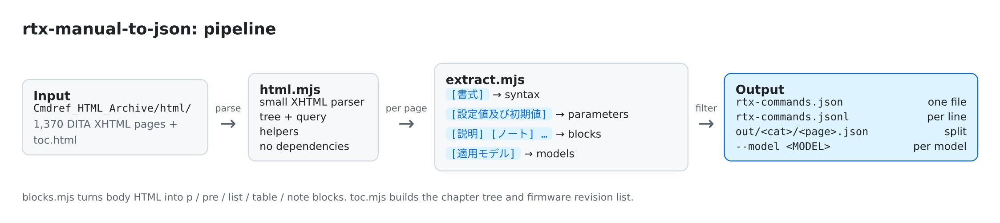
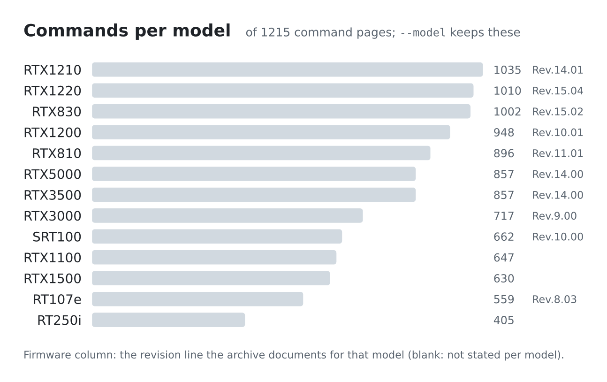
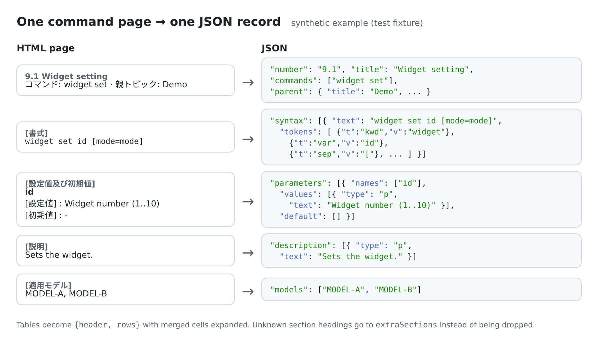

# rtx-manual-to-json

Converts the Yamaha RTX router command reference HTML archive (`Cmdref_HTML_Archive.zip`) into structured JSON: syntax tokens, parameters, defaults, tables, examples, and the applicable models for each command.

Plain Node.js ESM. No dependencies, no build step.



## Requirements

- Node.js 20+
- The archive. Download `Cmdref_HTML_Archive.zip` from https://www.rtpro.yamaha.co.jp/RT/manual/rt-common/ and extract it so `Cmdref_HTML_Archive/html/toc.html` exists.

## Usage

```bash
git clone https://github.com/didvc/rtx-manual-to-json
cd rtx-manual-to-json

node bin/rtx-manual-to-json.mjs                       # → rtx-commands.json
node bin/rtx-manual-to-json.mjs --jsonl               # → rtx-commands.jsonl (one page per line)
node bin/rtx-manual-to-json.mjs --split -o out        # → out/<category>/<page>.json + out/_toc.json
node bin/rtx-manual-to-json.mjs --include '^ip/' --pretty -o ip.json
node bin/rtx-manual-to-json.mjs -i path/to/html --commands-only --stats
node bin/rtx-manual-to-json.mjs --model RTX1220 -o rtx1220.json   # one model only
```

| flag | description | default |
|---|---|---|
| `-i, --input <dir>` | archive `html/` directory | `./Cmdref_HTML_Archive/html` |
| `-o, --output <path>` | output file (directory with `--split`) | `rtx-commands.json` / `.jsonl` / `out` |
| `--jsonl` | one JSON record per line | off |
| `--split` | one file per page | off |
| `--pretty` | indent output | off |
| `--include <regex>` / `--exclude <regex>` | filter by relative path, e.g. `<category>/<page>.html` | none |
| `--model <name>` | keep only commands that list this model in `[適用モデル]`; repeatable | all |
| `--commands-only` | skip concept and chapter pages | off |
| `--stats` | print input/output size | off |

The command exits with status 1 if any page fails to parse.

### Per-model output

Every command page lists the models it applies to under `[適用モデル]`. `--model` keeps only the commands for the models you name. The archive documents each model at one firmware line, shown in the chart below.



The filter keeps or drops whole commands. Firmware notes inside a command's text, such as "… は Rev.xx.yy.zz 以降", stay as they are.

## Output

One command page becomes one record. The example below is synthetic (it matches the test fixture), not taken from the reference:



In full:

```json
{
  "id": "demo_widget",
  "path": "demo/demo_widget.html",
  "kind": "command",
  "number": "9.1",
  "title": "Widget setting",
  "category": "demo",
  "parent": { "title": "Demo", "path": "demo/demo_chapter.html" },
  "commands": ["widget set"],
  "syntax": [
    {
      "text": "widget set id [mode=mode]",
      "tokens": [
        { "t": "kwd", "v": "widget" }, { "t": "kwd", "v": "set" }, { "t": "var", "v": "id" },
        { "t": "sep", "v": "[" }, { "t": "lit", "v": "mode" }, { "t": "sep", "v": "=" },
        { "t": "var", "v": "mode" }, { "t": "sep", "v": "]" }
      ]
    }
  ],
  "parameters": [
    { "names": ["id"], "values": [{ "type": "p", "text": "Widget number (1..10)" }], "default": [] }
  ],
  "description": [{ "type": "p", "text": "Sets the widget." }],
  "models": ["MODEL-A", "MODEL-B"]
}
```

The full schema is in [docs/schema.md](docs/schema.md).

## Library use

```js
import { convertPages, readToc, extractPage, blocksToText } from "./src/index.mjs";

for (const page of convertPages("Cmdref_HTML_Archive/html", { filter: (p) => p.startsWith("ip/") })) {
  if (page.kind === "command") console.log(page.commands[0], page.models.length);
}
```

## Layout

```
bin/rtx-manual-to-json.mjs   CLI
src/index.mjs                public API: convertPages, readToc, listPages
src/extract.mjs              one page → one record
src/blocks.mjs               body HTML → Block[] (paragraphs, lists, tables, pre, notes)
src/toc.mjs                  toc.html → tree
src/html.mjs                 small XHTML parser and query helpers
test/                        node:test suite with synthetic fixtures
assets/                      README images; Typst sources in assets/src/
```

To rebuild the images (tested with Typst 0.15; needs Noto Sans CJK JP):

```bash
cd assets/src && for f in pipeline mapping models; do typst compile --root .. --ppi 200 $f.typ ../$f.png; done
```

## Tests

```bash
node --test test/*.test.mjs
```

## Legal

"Yamaha" and "RTX" are registered trademarks of Yamaha Corporation. This project is independent and has no affiliation with, endorsement from, or sponsorship by Yamaha Corporation.

The command reference content is © Yamaha Corporation. This repository contains only converter code. No reference data is included or distributed. Download the archive yourself from the official site and follow its terms of use.

## Disclaimer

This software is provided "as is", without warranty. The parser may drop or misread content, and errors in the source documents carry through unchanged. Do not apply configuration derived from this output to production equipment without checking it against the official documentation and testing it first.

## License

Apache 2.0. See [LICENSE](LICENSE).

## Contact

Open an issue, or email `film-rigor-shingle[at]duck.com`.
